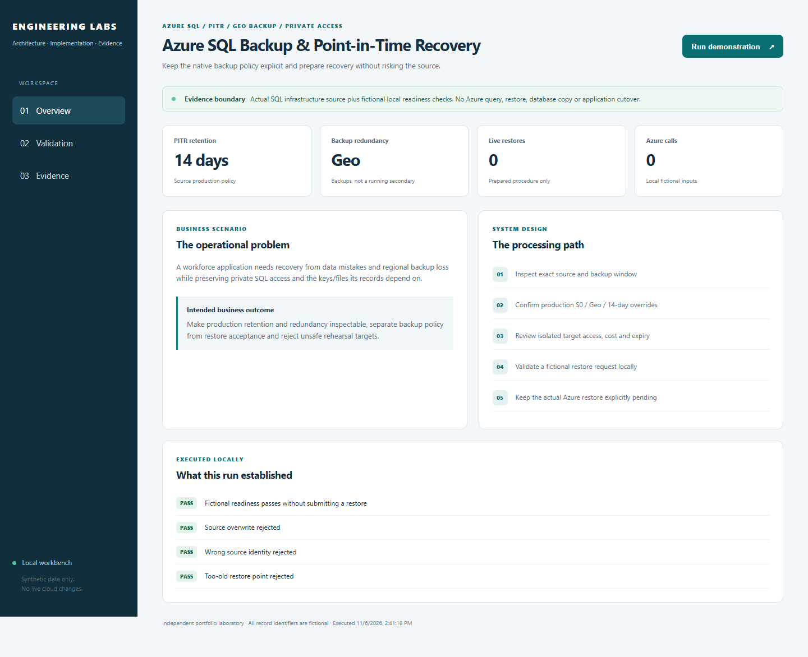
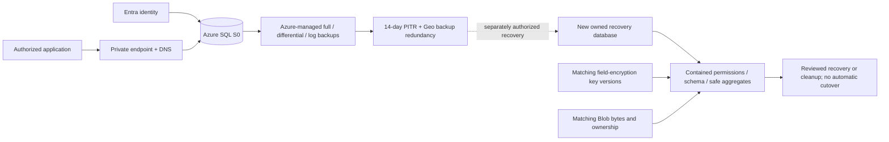
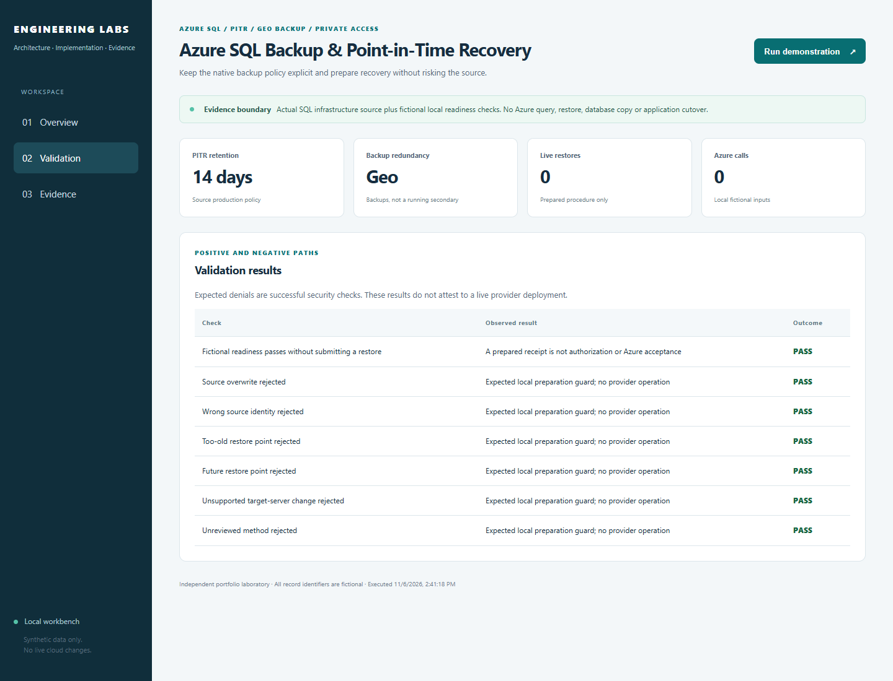

# Azure SQL Backup & Point-in-Time Recovery

**Prepare to restore the database without putting the current records at risk.**

[The problem](#the-business-problem) · [The solution](#the-solution) · [What was built](#what-was-built) · [Proof it works](#proof-it-works) · [Commands](docs/COMMANDS.md) · [Step by step](#step-by-step)



## The Business Problem

The application keeps employee, onboarding, timesheet and payroll records in Azure SQL. A mistake or outage needs a recovery plan that protects the original database and includes the files and encryption keys connected to those records. Backup settings alone do not prove a restore will work.

## The Solution

Make the database’s backup and retention settings explicit. Identify the recovery time and destination, prepare a separate restore environment, and check the private connection and related files and keys. Keep the difference between a planned restore and a completed restore test visible.

**Business outcome:** Make database recovery easier to prepare and review without overstating what has actually been restored and tested.

### Actual platform implementation

- The [SQL module](infra/modules/sql/main.tf) is actual implementation source with neutral resource labels and no private identifiers.
- The production caller supplies **Standard S0, Geo backup storage and 14-day point-in-time retention**. Nonproduction keeps the module's Basic/Local/seven-day defaults.
- The logical server has public network access Off, Entra-only administration, managed identity and TLS 1.2; private DNS/VNet linkage and a SQL private endpoint provide its selected private path.
- An October 4 module-ownership migration recorded six no-op address moves and a zero-change post-plan. It did not change the existing backup policy or restore data.
- The later SQL restore contract is **prepared, not executed**. Its historical schema-181 expectation must be refreshed before a future drill.

The local readiness program is newly authored reference code based on that procedure. It validates fictional inputs and submits no Azure operation. Source configuration, dated acceptance, tests using simulated cloud responses and a real restore are separate evidence. [Source map](docs/SOURCE-MAP.md) · [Acceptance matrix](docs/ACCEPTANCE.md).

## Tools Used and What They Do

| Tool or service | What it does | Where it fits |
| --- | --- | --- |
| Azure SQL Database backup/restore features | Provide supported database recovery methods and retained points. | Actual service capability; a new hosted restore was not executed for this project. |
| Azure CLI | Inspect supported recovery metadata and operation status. | Operating utility; the local checker has no cloud restore adapter. |
| T-SQL queries | Check schema, migration history, safe aggregates and effective permissions. | Selected validation queries; not a complete business acceptance suite. |
| Microsoft Entra ID and contained SQL users | Control which identity can connect and execute database operations. | Actual access layers; administrative reads do not prove runtime grants. |
| Azure Key Vault and Blob Storage | Supply encryption-key and file dependencies needed by the recovered application. | Separate recovery dependencies, not restored merely by SQL PITR. |
| Python and Terraform | Check fictional recovery plans and selected infrastructure defaults. | Local/reference validation; not measured production RTO or restore completion. |

Point-in-time restore, database copy and geo-restore are different operations. The manual-only GitHub workflow does not submit any of them.

## Step by Step

A short walkthrough of the process, with technical instructions and evidence limits in the sections below.

1. **Review backup coverage (Azure SQL metadata)** — Confirm the database backup retention and the time range available for recovery. Keep live and test environment settings distinct.

2. **Choose a separate destination** — Identify the intended recovery time and an isolated restore target. Check ownership, network access and related files or keys before proceeding.

3. **Run the readiness checks (Python readiness checker)** — The local checker tests the proposed recovery details using fictional inputs. It does not submit an Azure restore or replace the live database.

4. **Plan the final verification** — The prepared rehearsal calls for checking restored records, access and application compatibility. That live restore rehearsal has not been completed in this case study.

## Architecture



Geo backup storage is not a running secondary database or automatic application failover. This project adds no custom SQL backup worker, BACPAC schedule or Azure Backup vault.

## What Was Built

| Component | Role in plain words | Implementation |
| --- | --- | --- |
| Actual SQL Terraform module | Defines server/database, retention, private DNS/link and endpoint | [Module](infra/modules/sql/) |
| Explicit environment profiles | Preserve production S0/Geo/14 versus Basic/Local/seven-day defaults | [Root](infra/main.tf) |
| Original prepared SQL contract | Record the required preparation and test conditions without claiming a restore was performed | [Contract](reference/sql-rehearsal-contract.json) |
| Local readiness checker | Reject wrong source, existing/unowned target, invalid point and incomplete isolation | [Code](lab/readiness.py) |
| Positive and negative tests | Exercise preparation boundaries without SQL credentials or provider access | [Tests](tests/test_readiness.py) |
| Read-only validation query | Gather schema/catalog/principal aggregates only on an owned target | [SQL](queries/isolated-restore-validation.sql) |

## Proof It Works

**Local validation:** 16 readiness tests, seven demo assertions and three Terraform tests using simulated cloud responses passed. No cloud restore or resource operation.

### 1. Infrastructure preserves the production policy and private boundary

```bash
terraform -chdir=infra init -backend=false -input=false
terraform -chdir=infra validate
terraform -chdir=infra/modules/sql init -backend=false -input=false
terraform -chdir=infra/modules/sql test
```

**Look for:** three mock-plan tests verify production overrides, separate nonproduction defaults, Entra-only/private SQL and the SQL DNS/endpoint binding. They do not create a server or prove a live network route. [Terraform guide](infra/README.md).

### 2. Unsafe preparation requests fail locally

```bash
python -B -m unittest discover -s tests -v
python -B -m lab demo
```

**Look for:** wrong-source, source-overwrite, existing-target, future/too-old point, unsupported method/server and missing-isolation cases are rejected. The successful result says **prepared-not-submitted**, with `productionAuthorization=false` and zero Azure operations. It is not a restored database.

### 3. Evidence is visible and reproducible



Desktop/mobile screenshots are captured from this working program. Green checks describe fictional readiness guards, not successful Azure restores. [Dated validation](docs/VALIDATION.md) records exact counts and limits.

## Run It Locally

Python 3.12; standard library only:

```bash
python -m venv .venv
source .venv/bin/activate
python -B -m unittest discover -s tests -v
python -B -m lab demo
python -B -m lab serve --port 8011
```

PowerShell: invoke `.venv\Scripts\python.exe` directly instead of activating. Open [the loopback workbench](http://127.0.0.1:8011), run the demonstration and inspect Validation/Evidence. Stop with Ctrl+C. No Azure login, actual database or paid request is needed.

## Backup and Restore Process

Azure SQL owns its automatic backup schedule. Our Terraform controls selected retention and backup redundancy; it does not run a cron script to export the database.

For a real recovery: inspect the available backup window, select the correct method/point, review the exact owned target and private/custodian access, restore, validate database and external dependencies, measure time/loss window, then make a separate cutover or cleanup decision. [Step-by-step procedure](docs/RESTORE-REHEARSAL.md).

The documented standard CLI PITR path creates another database on the source logical server. A dedicated-server recovery design needs an explicitly supported method or additional stage; do not assume `az sql db restore` accepts the copy command's `--dest-server` option. The local checker intentionally supports only its stated same-server preparation mode.

## Security Practices

- Keep restore targets separate and do not update live application connection bindings.
- Review contained users and permissions; a new database name alone does not isolate restored identities.
- SQL recovery still needs matching Blob metadata/bytes and application field-encryption key versions.
- A database's TDE protection and the application's Key Vault field-encryption wrapper are distinct layers.
- Terraform `prevent_destroy` is a source guard, not a cloud-wide denial of every administrator's delete operation.
- Real resource IDs, database contents, tokens, connection strings and Terraform state stay out of this repository.

## Scaling and Tradeoffs

Fourteen-day retention is a time window, not a guaranteed RPO or restore duration. Larger databases, transaction replay, target compute, private networking and dependencies affect recovery. Geo backups and longer retention add storage/transfer considerations. [Strengths, weaknesses and tradeoffs](docs/SCALING.md).

## Troubleshooting Lessons

A production review action exposed a missing column grant, and a wider check found other runtime write gaps. The repair used exact grants and application-identity probes, illustrating why a correct schema alone does not establish a usable database. [Read the incident, evidence and verification](docs/LESSONS-LEARNED.md).

## Project Guides

| Guide | Purpose |
| --- | --- |
| [Architecture](docs/ARCHITECTURE.md) | SQL, backup, private access and external dependency boundaries |
| [Native backups](docs/NATIVE-BACKUPS.md) | PITR, geo-restore, LTR and BACPAC distinctions |
| [Restore rehearsal](docs/RESTORE-REHEARSAL.md) | Method selection, isolation, acceptance and cleanup |
| [Command reference](docs/COMMANDS.md) | Local checks and optional read-only cloud inspection examples |
| [Source map](docs/SOURCE-MAP.md) | Actual module versus newly authored reference code |
| [Acceptance](docs/ACCEPTANCE.md) | Completed ownership work versus unexecuted restore |
| [Operations](docs/OPERATIONS.md) | Diagnose window, identity, DNS and dependency failures |
| [Scaling](docs/SCALING.md) | RPO/RTO, capacity, retention and tradeoffs |
| [Capture plan](docs/SCREENSHOT-PLAN.md) | Future nonproduction Portal/terminal evidence |

## Cost and Cleanup

No service is started or changed for this public project. Applying Terraform creates billable SQL/network resources; no apply workflow is supplied. The real module's deletion guard makes cleanup an explicit reviewed operation. The GitHub workflow is manual-only and has no Azure deployment credentials. [Security and publication boundary](SECURITY.md).
